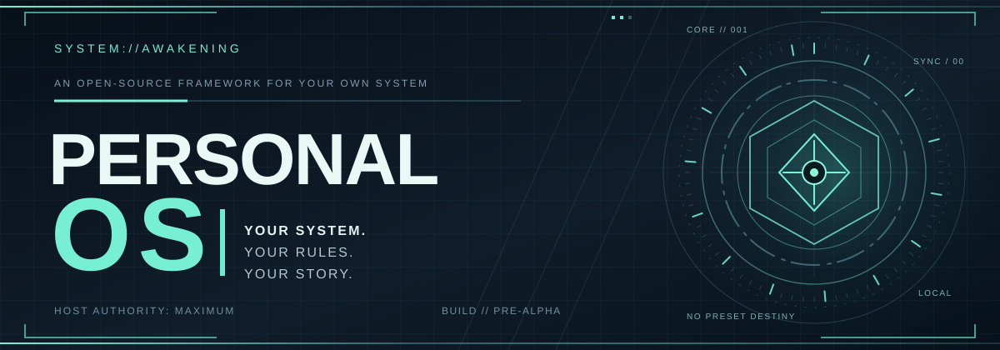
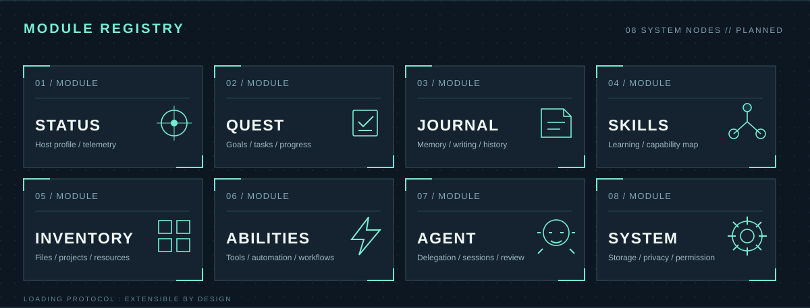
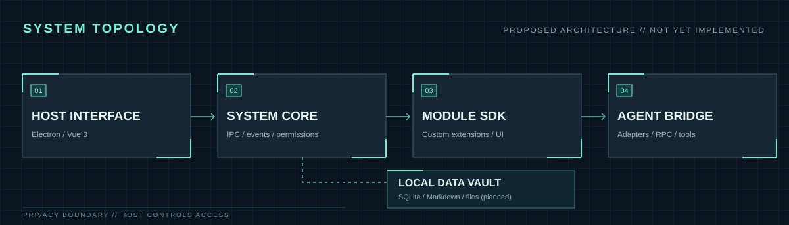
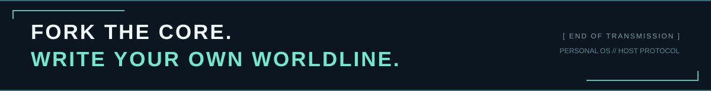

<div align="center">
  

  <h1>PERSONAL OS</h1>

  <p><strong>[ SYSTEM INITIALIZATION // PRE-ALPHA ]</strong></p>

  <p>一个用于构建专属个人系统的本地优先、可扩展桌面框架。</p>

  <p><code>LOCAL FIRST</code> · <code>MODULAR</code> · <code>AGENT-READY / PLANNED</code></p>

  <p><strong>Your System. Your Rules. Your Story.</strong></p>
</div>

> [!NOTE]
> **当前状态：PRE-ALPHA。** 仓库已经建立 Electron + Vue 3 + TypeScript 的工程骨架与初步页面；任务持久化、日记数据库、插件 SDK、Agent 执行等核心能力仍处于开发计划中。下文的「系统」为产品设计愿景，不表示全部功能已经实现。

---

**[ SYSTEM BOOT SEQUENCE ]**

> **[ SYSTEM INITIALIZATION ]**
>
> 正在识别宿主……
>
> 正在加载个人档案……
>
> 正在建立本地数据连接……
>
> 正在初始化辅助智能……
>
> **系统初始化完成。**
>
> 欢迎回来，宿主。
>
> 从现在开始，你的人生将拥有一个可以被观察、记录、规划与管理的界面。

---

## 01. 系统介绍 / ABOUT

**Personal OS** 是一个运行于本地计算机的个人辅助系统。

本系统旨在将现实生活中的个人信息、目标、任务、知识、资源与人工智能能力整合至统一的管理环境。

不同于传统的笔记软件、日程管理器或 AI 聊天工具，Personal OS 并不局限于某一种功能。

它试图回答一个更根本的问题：

**如果现实中的人类也能拥有小说中的「系统」，那会是什么样子？**

在这里：

- 你的现实经历将成为系统日志。
- 你的长期目标将成为主线任务。
- 你的日常计划将成为每日任务。
- 你的知识与经验将构成技能树。
- 你的文件与资源将进入个人物品栏。
- 你的工具与 AI Agent 将成为可调用的系统能力。
- 你的每一次行动都可以成为成长的依据。

系统不会赋予你超自然的力量。

但它可以帮助你更充分地利用已经拥有的时间、知识、资源与计算能力。

> **[ SYSTEM MESSAGE ]**
>
> 宿主并未获得超能力。
>
> 宿主只是获得了一套能够辅助理解自身、组织信息并执行复杂任务的系统。
>
> 从某种意义上说，这已经足够接近超能力。

---

<div align="center">
  
</div>

> **[ MODULE REGISTRY ]** 以下为系统模块的设计蓝图。每位宿主都可以对这些能力进行组合、替换或自行开发。

## 02. 宿主档案 / STATUS

**「了解自己，是一切成长的起点。」**

系统将尝试建立一个持续更新的宿主档案。

该档案并非静态的个人资料，而是由日常活动、项目记录、任务完成情况和其他获得授权的数据共同构成。

### 基础状态

- **PROFILE** — 个人档案与基础信息
- **ACTIVITY** — 日常活动与时间分配
- **PROJECTS** — 当前项目与历史成果
- **RESOURCES** — 可支配资源与个人资产
- **PROGRESS** — 目标推进情况
- **HISTORY** — 历史活动与成长记录

系统允许通过统计和可视化的方式观察不同时间尺度下的个人变化。

系统会尽可能通过事实回答这些问题。

**注意：系统并不具有全知能力。**

所有数据都应区分真实记录、计算结果与 AI 推测。任何能力评价或成长等级都不应伪装成客观事实。

---

## 03. 任务系统 / QUEST

> **[ NEW QUEST AVAILABLE ]**
>
> 新的目标已建立。
>
> 正在分析目标结构……
>
> 正在生成候选执行方案……
>
> 请宿主确认任务计划。

任务系统负责把模糊、遥远、容易停滞的现实目标拆解为可以被执行、记录和回顾的行动。

### 主线任务 / MAIN QUEST

主线任务代表宿主希望长期实现的重要目标，例如完成一款独立游戏、掌握一项技术，或实现某个长期的人生计划。

### 支线任务 / SIDE QUEST

支线任务是那些不一定直接服务于主线，但仍然具有价值的事情，包括阅读、兴趣探索、生活事务、短期项目以及偶然产生的想法。

### 每日任务 / DAILY QUEST

每日任务将长期规划转化为当下可以执行的行动。系统计划支持任务优先级、截止时间、周期重复、子任务、日历视图和进度统计。

### 动态任务 / DYNAMIC QUEST

在获得宿主授权后，AI 可以根据已有目标、任务状态及历史记录提出新的行动建议。

**系统可以建议任务，但最终决定权始终属于宿主。**

---

## 04. 系统日志 / JOURNAL

**「未被记录的经历，往往比想象中消失得更快。」**

系统提供一个可长期保存的个人记录空间。

你可以在这里记录：

- 每日经历与想法
- 技术学习与实验过程
- 游戏创意与设计草稿
- 项目决策与失败经验
- 阅读笔记与知识总结
- 值得保存的生活片段

日志使用 Markdown 等开放、可迁移的格式保存在本地。

系统计划支持标签、关联项目、全文搜索、时间轴与周期性回顾。

未来，在明确授权的前提下，AI 可以检索这些内容并回答：

> 「我第一次产生这个想法是什么时候？」
>
> 「过去半年，我到底完成了什么？」
>
> 「为什么三个月前，我放弃了那个项目？」

系统不会凭空记得你的人生。

**它只能从被允许访问的记录中，重新发现你曾经留下的答案。**

---

## 05. 技能系统 / SKILLS

> **[ SKILL TRACKING ENABLED ]**
>
> 检测到新的学习活动。
>
> 正在关联知识节点……
>
> 成长记录已更新。

现实生活中不存在明确的技能等级，但学习、练习和成果可以被记录。

技能系统计划通过知识节点、学习计划、项目实践和历史成果，帮助宿主观察自己在不同领域中的成长。

例如：

- Programming — 软件工程
- Mathematics — 数学
- Engineering — 工程与硬件
- Languages — 语言学习
- History — 历史研究
- Creation — 创作与设计

系统可以建立技能之间的关联，并形成宿主的个人技能图谱。

系统可以根据学习记录提供掌握程度的估计，但不会仅凭学习时长或任务数量认定某项技能已经掌握。

---

## 06. 物品栏 / INVENTORY

**「你所拥有的资源，也应当成为你能力的一部分。」**

系统物品栏并非传统意义上的文件管理器。

它是用于组织个人数字资源与工具的统一入口。

包括：

- 本地文件与知识资料
- 软件项目与 Git 仓库
- 常用工具与脚本
- 设备与硬件资料
- 可复用的代码与资源
- AI Skills、MCP 服务与工作流

文件依然可以保留在原来的目录中。Personal OS 不应强迫宿主将所有东西迁移至某一个封闭的数据仓库。

---

## 07. 特殊能力 / ABILITIES

> **[ ABILITY SYSTEM ]**
>
> 正在加载可用能力……
>
> 本地工具接口已准备就绪。
>
> AI 能力将在授权后启用。

如果说任务系统负责决定应该做什么，那么能力系统负责帮助宿主完成这些事情。

Personal OS 将工具、自动化脚本和 AI Agent 统一视为可以调用的能力。

### 知识解析 / KNOWLEDGE ANALYSIS

调用 AI 阅读指定资料，进行总结、概念提取、结构化整理和问题分析。

### 代码辅助 / CODE ASSISTANCE

通过本地 Agent 连接指定开发项目，进行代码检索、问题分析、修改建议与经批准的开发操作。

### 任务分身 / TASK DELEGATION

将可委托的工作分配给一个或多个 Agent，并通过统一界面查看运行状态、执行日志和最终结果。

### 自动执行 / AUTOMATION

按照预设规则执行重复性任务，例如文件处理、计划汇总、数据整理与周期性检查。

### 记忆检索 / MEMORY RETRIEVAL

在授权范围内检索个人日记、历史任务、项目资料和活动记录，向宿主提供具有来源依据的回答。

**系统能力的上限，取决于可使用的工具、模型、数据以及宿主授予的权限。**

---

## 08. 辅助智能 / AGENT

**「一个人的时间有限，但可被委托的工作不一定如此。」**

AI Agent 是 Personal OS 的重要组成部分，但并不是系统本身。

系统负责管理个人数据、任务和资源；Agent 则负责在授权范围内进行推理、分析及执行。

计划支持：

- Agent 注册与配置
- 工作目录管理
- 模型与服务商选择
- 会话管理与历史记录
- 实时执行状态和日志
- Token 与成本统计
- 工具权限和操作审批
- 定时任务与自动化触发
- 多 Agent 任务协作

首个计划接入的 Agent 是 **Pi**。

### 权限协议

所有 AI Agent 都必须遵循系统权限边界。

对于删除文件、修改重要项目、访问私人资料、执行外部命令等操作，系统应提供可配置的授权与审批机制。

> **[ SECURITY NOTICE ]**
>
> 辅助智能不是宿主的替代者。
>
> 它可以提出建议、执行授权任务、提供分析结果。
>
> 但最终控制权属于宿主。

---

## 09. 系统核心 / ARCHITECTURE

Personal OS 计划作为 Windows 本地桌面应用运行，并提供开机启动、系统托盘和后台任务能力。

<div align="center">
  
</div>

> **[ ARCHITECTURE NOTE ]** 上图为目标架构，并非当前已交付的完整实现。系统计划将宿主界面、内核、模块和 Agent 适配层分离。

### 技术栈

| 模块          | 技术                              |
| ------------- | --------------------------------- |
| Desktop       | Electron                          |
| Frontend      | Vue 3 + TypeScript                |
| Build         | electron-vite                     |
| UI            | Naive UI + UnoCSS                 |
| State         | Pinia                             |
| Database      | SQLite + Drizzle ORM              |
| Documents     | Markdown                          |
| Agent         | Pi RPC + Node.js                  |
| Background    | Node.js / Electron UtilityProcess |
| Communication | Electron IPC                      |
| Distribution  | electron-builder                  |

系统采用模块化架构。

主要包括状态中心、任务系统、日志系统、技能系统、资源管理、能力中心和 Agent 管理中心。

所有模块通过统一的数据模型、服务接口和事件记录机制协同工作。

### 本地优先 / LOCAL FIRST

宿主的数据首先属于宿主。

Personal OS 的核心数据将默认保存在本地设备中，并计划提供备份、恢复和导出机制。

本地优先不代表所有 AI 推理都必须离线执行。使用云端模型时，相关数据可能被发送给模型服务商。系统应明确区分本地操作与网络请求，并提供对应的授权控制。

---

### 启动开发环境 / BOOT SEQUENCE

当前仓库已有 Electron + Vue 3 + TypeScript 工程骨架，可用于继续开发系统内核。

```bash
git clone https://github.com/RinKokawa/Personal-OS.git
cd Personal-OS
npm ci
npm run dev
```

工程检查命令：`npm run typecheck`、`npm run lint`、`npm run build`。

> **[ SYSTEM NOTICE ]** 以上命令用于运行当前开发骨架，并不意味着日记、任务、Agent 等规划功能已经完成。详细执行顺序参阅 [WORK PLAN](./docs/WORK_PLAN.md)。

---

## 10. 系统升级 / ROADMAP

**当前开发状态：PRE-ALPHA — 工程骨架已建立，核心能力开发中。**

以下为计划中的能力，不代表已经实现。

### VERSION 0.1 — 系统觉醒

- [ ] Electron 桌面应用基础
- [ ] 主界面与系统状态面板
- [ ] 日记及 Markdown 编辑器
- [ ] Todo 与基础任务管理
- [ ] SQLite 本地数据存储
- [ ] 系统托盘与开机启动

### VERSION 0.2 — 任务展开

- [ ] 长期目标管理
- [ ] 项目与子任务关联
- [ ] 日历与时间规划
- [ ] 任务统计和每日复盘
- [ ] 全局搜索与快捷命令

### VERSION 0.3 — 能力解锁

- [ ] 工具箱
- [ ] 工具注册与统一调用
- [ ] 自定义脚本与工具模块
- [ ] 本地资源索引

### VERSION 0.4 — 辅助智能上线

- [ ] Pi Agent 接入
- [ ] Agent 配置与会话管理
- [ ] 执行日志与状态监控
- [ ] 权限管理与人工审批

### VERSION 0.5 — 系统联动

- [ ] Agent 与个人任务关联
- [ ] 自动化调度
- [ ] 日记与知识检索
- [ ] 活动记录与智能复盘
- [ ] 技能成长与成果追踪

### VERSION 1.0 — 完整系统

建立由个人数据、任务规划、知识记录、工具调用、AI Agent 与成长反馈组成的统一工作环境。

---

## 11. 宿主协议 / HOST PROTOCOL

> **[ SYSTEM ANNOUNCEMENT ]**
>
> 系统内核已开放。
>
> **欢迎 Fork，欢迎改写，欢迎构建属于自己的分支世界线。**
>
> 每一位宿主都有不同的目标、习惯、审美、工具链与行动方式。
>
> 本系统无意为所有人提供统一答案，也不试图定义何为最完美的个人系统。
>
> 因此，系统鼓励宿主在自己的分支中自由探索、修改、扩展与创造。
>
> 对于个性化功能、界面偏好、工作流差异与私人需求，请优先在自己的世界线中实现。
>
> 请尽可能减少不必要的 Issues 与 Pull Requests。
>
> 对于影响系统内核的共性缺陷、安全问题、架构问题与关键兼容性问题，系统仍然欢迎反馈。
>
> ---
>
> 请记住：
>
> **你不是系统的使用者。**
>
> **你是自己系统的创造者。**
>
> 系统提供起点，而非终点。
>
> **你的世界线，由你自己书写。**
>
> **[ END OF TRANSMISSION ]**

---

## 12. 最终指令 / FINAL DIRECTIVE

> **[ SYSTEM STATUS ]**
>
> SYSTEM: PERSONAL OS
>
> MODE: LOCAL FIRST
>
> USER AUTHORITY: MAXIMUM
>
> DEVELOPMENT: IN PROGRESS
>
> NEXT OBJECTIVE: BUILD THE SYSTEM

**系统正在构建中。**

**祝你好运，宿主。**

<div align="center">
  

  <sub>Personal OS · Your System. Your Rules. Your Story.</sub>
</div>
